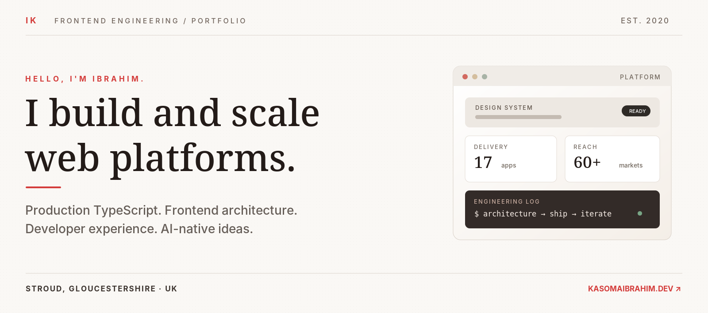
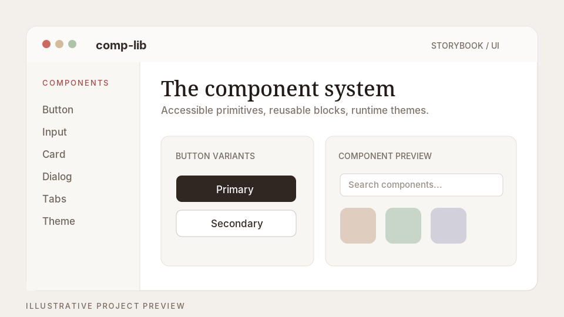
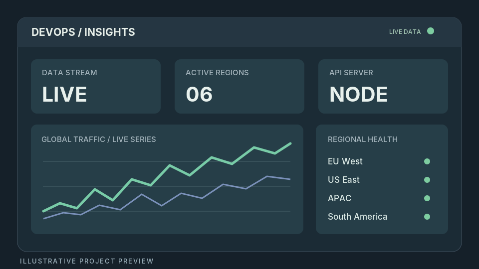
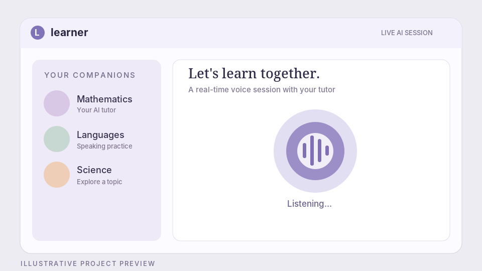

<!-- GitHub profile README — Ibrahim Kasoma | Updated November 2026 -->

<h1>Hey, I'm Ibrahim. 👋</h1>

Senior Frontend Engineer · Frontend Platforms · Developer Experience · AI-assisted Engineering
Building things for the web, and the systems that make them easier to build.

📍 Stroud, Gloucestershire, UK · Open to senior frontend / frontend-platform roles

  
  
  

01 / A little about me
I enjoy making complicated software feel simple — not by hiding the complexity, but by giving it structure.
I'm a frontend engineer with 6+ years of production experience, working across TypeScript, React, Next.js and backend-integrated applications. At EF Education First, I work on international consumer experiences and the shared architecture, tooling and delivery pipelines behind them. I care as much about the path from idea to production as I do about the interface itself.
Outside work, I build design systems, real-time applications and AI-native experiments. I like readable code, thoughtful abstractions, small iterations and the occasional ambitious idea.

17 production frontends	60+ markets	45 → 15 min	60% faster
Shared delivery platform	International reach	CI pipeline	EF EPI page loads

Selected results from my work at EF. More context and case studies →
02 / Selected work
A few places where architecture, performance and product engineering meet:
Product	What I worked on
EF English Proficiency Index	Next.js data visualisation and performance work; 60% reduction in page load time.
EF global homepage	Consumer-facing platform work supporting international markets and frequent releases.
EF programmes catalogue	Nx monorepo architecture consolidating 20+ microfrontends across eight product teams.

03 / Things I've built
<table>
<tr>
<td width="50%" valign="top">

<h3>comp-lib</h3>
A component system with 40+ accessible primitives, reusable blocks, runtime themes and agent-readable documentation.
  
<code>React</code> <code>TypeScript</code> <code>Storybook</code> <code>Tailwind</code>
  
<a href="https://complib.kasomaibrahim.dev/">Explore Storybook ↗</a> · <a href="https://github.com/akibrahimug/comp-lib">View code ↗</a>
</td>
<td width="50%" valign="top">

<h3>DevOps Insights</h3>
A multi-region monitoring dashboard with real-time updates, a Node.js backend and WebSocket-driven data delivery.
  
<code>Next.js</code> <code>Node.js</code> <code>WebSockets</code> <code>MongoDB</code>
  
<a href="https://devops.kasomaibrahim.dev/">Live demo ↗</a> · <a href="https://github.com/akibrahimug/devops-insights">View code ↗</a>
</td>
</tr>
<tr>
<td width="50%" valign="top">

<h3>Learner</h3>
An AI teaching experience with subject-specific voice companions, real-time sessions, transcripts and learning history.
  
<code>Next.js</code> <code>TypeScript</code> <code>Clerk</code> <code>Supabase</code> <code>Voice AI</code>
  
<a href="https://learner.kasomaibrahim.dev/">Visit app ↗</a> · <a href="https://github.com/akibrahimug/learner">View code ↗</a>
</td>
<td width="50%" valign="top">
<h3>More projects worth a look</h3>

🌿 <a href="https://www.puurugandareizen.nl/"><b>Puur Uganda Reizen</b></a> An editorial, CMS-driven travel experience. <a href="https://github.com/akibrahimug/puur-safaris">Source ↗</a>

🦍 <a href="https://www.oliotyaugandasafaris.com/"><b>Oliotya Uganda Safaris</b></a> An image-led tourism and discovery site. <a href="https://github.com/akibrahimug/Oliotya-Uganda-Safaris">Source ↗</a>

✳️ <a href="https://www.igcfashion.africa/"><b>IGCFashion</b></a> A fashion catalogue built around visual storytelling. <a href="https://github.com/akibrahimug/igc-site">Source ↗</a>

<a href="https://www.kasomaibrahim.dev/">See more of my work ↗</a>

</td>
</tr>
</table>

04 / AI isn't just a chat window
I'm interested in agent-ready engineering: codebases that communicate their own conventions, boundaries and interfaces clearly enough for humans and coding agents to work effectively.
- AGENTS.md and CLAUDE.md — repository-level guidance for architecture, contribution patterns and workflows.
- llms.txt and registry.json — discoverable, machine-readable documentation for my component library.
- AI-native applications — exploring real-time voice interaction and learning experiences through Learner.
- Engineering judgement stays central — tests, accessibility, security, reviews and clear ownership matter more, not less, when agents write code.
05 / My toolkit

Frontend & product engineering

Platforms, delivery & testing

Also: Nx · Storybook · React Testing Library · Cypress · Sentry · REST · Express · WebSockets · CMS integrations · CI/CD
06 / Currently exploring
- Frontend platforms: monorepos, design systems, build pipelines, deployment tooling and observability.
- AI-assisted engineering: agent instructions, structured context, better workflows and AI-native interfaces.
- Infrastructure: Docker, Terraform, Kubernetes and cloud fundamentals.
- Better software, not just more software: performance, maintainability and developer experience.

Have a project, a challenge, or an interesting idea?
I'm always up for a conversation about frontend architecture, developer platforms, AI, or something worth building.
Explore my portfolio · Connect on LinkedIn · Email me
Thanks for stopping by. 👋

